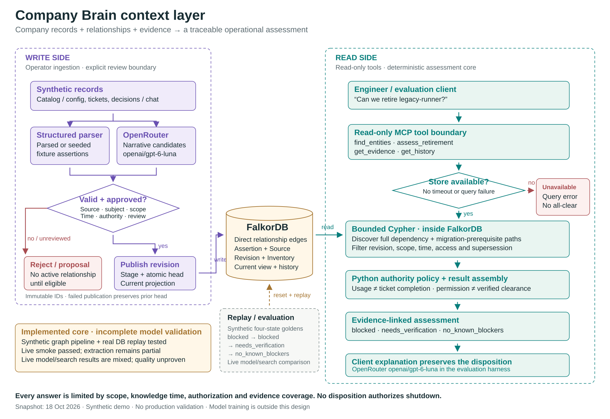

# Company Brain — service retirement with evidence

Can we retire an old service without breaking billing? A completed migration ticket is only one record. Runtime usage, business consumers, ownership, approval blockers and temporary exceptions may disagree.

Company Brain connects these records in **real FalkorDB**, then returns a deterministic, scoped assessment with source evidence through four read-only MCP tools. A client can explain the answer; it must preserve the returned disposition.

The synthetic Lumora story follows **monthly billing → invoice export → legacy runner**. Invoice migration is blocked by network approval. Data Platform owns the export; Security owns the approval. A temporary exception permits continued use until **2026-11-01T00:00:00Z (exclusive)**. Permission to keep using a service does not prove migration or authorize retirement.

## See the graph



[Interactive architecture](presentation-assets/company-brain-architecture-current/company-brain-current-architecture.html)

The architecture is a high-level map. Dated verification below is the measurement source; the diagram is not a benchmark.

Immutable revisions store `Entity`, `Source`, `Assertion` and declared `Inventory` records, plus immutable proposal-review audit records. Direct relationship edges carry assertion IDs back to exact source/version/quote spans. The readable `CurrentEntity` projection includes `REQUIRES`, `RUNS_ON`, `MIGRATION_TRACKED_BY`, `BLOCKED_BY`, `OWNED_BY` and `PERMITS_USE`; prior projections and evidence remain historical. Assessment queries use revision data with dynamic eligibility at the requested scope and times.

Narrative extraction produces **candidate facts**. Validation checks types, scope, time, source authority and exact quoted spans. Activating an extracted claim requires a trusted operator's reviewed digest of the full candidate; changed fields require fresh review. Valid unreviewed claims remain proposals. MCP exposes no ingestion, approval or infrastructure actions. A [recorded live-extraction and selected-approval walkthrough](presentation-assets/reviewed-demo/README.md) is verified on actual FalkorDB. The reviewer action is explicitly a synthetic demonstration, not human acceptance. The [live Luna CLI client](presentation-assets/mcp-client-demo/LUNA-DEMO.md) uses the official MCP SDK over stdio; it is not a desktop UI or a recorded video.

## Run locally

From `company-brain/`, use Python 3.13 and `uv`. No model API key is needed for setup, seeded replay or the deterministic mock extraction path.

```sh
uv venv .venv --python 3.13
uv pip install --python .venv/bin/python -r requirements.lock
uv pip install --python .venv/bin/python --no-build-isolation --no-deps -e .
mkdir -p .local
export COMPANY_BRAIN_LITE_PATH="$PWD/.local/retirement.rdb"
export COMPANY_BRAIN_GRAPH=company_brain_demo_retirement
export COMPANY_BRAIN_KNOWN_AT=2026-10-17T12:00:00Z
.venv/bin/company-brain validate data/synthetic/initial.json
.venv/bin/company-brain ingest data/synthetic/initial.json
.venv/bin/company-brain-mcp
```

Use a fresh dedicated demo graph. To restart an existing demo, the operator command is `.venv/bin/company-brain reset --confirm-graph company_brain_demo_retirement`; this deletes only the explicitly confirmed graph. FalkorDBLite embeds the actual database. The Docker route has not been exercised on this machine. [Full setup and security boundaries](docs/development/18-local-development.md).

For a stdio client, configure the absolute `.venv/bin/company-brain-mcp` executable and all three environment variables above, with an absolute database path. The historical `COMPANY_BRAIN_KNOWN_AT` value must also reach the client process; otherwise current UTC makes historical observations stale.

## Demo in four states

Ask: “Can we retire legacy-runner in production/eu at 2026-10-17T12:00:00Z? Show business dependencies, owners, blockers, exceptions and evidence.” Resolve the ID using `find_entities`, call `assess_retirement`, inspect passages with `get_evidence`, and inspect changes with `get_history`. [Scripted SDK protocol proof](presentation-assets/mcp-client-demo/current-schema/protocol-transcript.json) covers all four tools and 13 exact spans on the current schema. [The separate live model-through-MCP result](presentation-assets/mcp-client-demo/LUNA-RESULT.md) preserves verdict, gaps, conflicts, permission expiry and 13 matching citations; its failed prior attempt is retained.

Use operator ingestion between assessments:

| Ingest in order | Expected assessment | What changed |
|---|---|---|
| `data/synthetic/initial.json` | `blocked` | Billing requires invoice export on the old runner; network approval blocks migration; reporting evidence is stale. |
| `data/synthetic/completion.json` | `blocked` | Ticket completion conflicts with runtime usage; the dependency remains. |
| `data/synthetic/migration.json` | `needs_verification` | Verified migration removes billing impact; reporting still lacks fresh verification. |
| `data/synthetic/clear.json` | `no_known_blockers` | Fresh target-scoped reporting verification closes the remaining gap within declared inventory. |

CLI assessment for each state:

```sh
.venv/bin/company-brain assess legacy-runner --environment production --region eu --planned-at 2026-10-17T12:00:00Z --known-at 2026-10-17T12:00:00Z
```

Every result is limited by scope, time, visible evidence and declared inventory. `no_known_blockers` is not shutdown approval. Database failure is an error; stale, conflicting or exhausted evidence cannot silently become clearance.

## Narrative → selected review → changed graph answer

The recorded Luna run validated 13 raw records and proposed 11 facts, with **zero automatic approvals**. Four claims were explicitly checked against their full synthetic sources: invoice runtime, the billing prerequisite, export ownership and the dated permission. The remaining seven proposals stay unapproved. The independent migration-tracking record yielded no claim; validation counts are not fact accuracy.

```sh
# No API call. Choose a fresh output directory; this boots its own actual FalkorDB.
.venv/bin/python presentation-assets/reviewed-demo/replay_approval.py --output .local/recording-review-1
```

This runs the real operator CLI to list candidates, ingest inactive proposals, assess, approve four exact IDs, inspect the audit, ingest approved copies and reassess. The same scope and assessment time change from **needs_verification → blocked**, with billing impact, Data Platform ownership and the exception supported by approved evidence. Earlier knowledge still returns needs_verification. It demonstrates conservative activation of selected facts, not a successful migration or clearance. [Exact commands, selected IDs, before/after revisions and source evidence](presentation-assets/reviewed-demo/README.md).

`REQUIRES` can use explicitly declared prerequisite validity; runtime `RUNS_ON`/`DEPENDS_ON` retain observation freshness. The two raw prerequisite records are version 2 with operator-declared synthetic intervals and unchanged text, not invented runtime dates. Approval records actor/kind, time, selected IDs, source/version and full-claim digests. Evidence visibly labels demonstration approval. [Review/time semantics](docs/development/proposal-review.md).

## Exact main Cypher

This is `dependency_query(8)` in [store.py](src/company_brain/store.py), checked against [the query artifact](evals/results/rereview-traversal.cypher) at the tested implementation `985f0c7`. FalkorDB resolves eligible assertions and supersession, then traverses dependency and migration-prerequisite paths. Python assembles operational policy and evidence; it does not run BFS or generate a traversal ID list. Parameters supply revision, target, environment/region, epoch planned/known times, trusted visibility groups and row budget plus one. The ninth hop detects the eight-hop budget boundary; excess depth/rows mean incomplete coverage. Query timeout is 1.5 seconds and returns an error on failure.

```cypher
MATCH (a:Assertion {rev:$rev})
WHERE a.status='approved' AND a.environment=$environment
      AND a.region=$region AND a.effective_from <= $planned
      AND (a.effective_until IS NULL OR $planned < a.effective_until)
      AND a.recorded_at <= $known
      AND (a.approved_at IS NULL OR a.approved_at <= $known)
      AND (a.observed_at IS NULL OR a.observed_at <= $known)
      AND (NOT a.predicate IN ['RUNS_ON','DEPENDS_ON','REQUIRES','VERIFIED_CLEAR']
           OR a.time_basis='validity' OR a.effective_from <= $known)
      AND a.revoked=false
      AND a.source_visibility IN $groups AND a.subject_visibility IN $groups
      AND a.object_visibility IN $groups AND a.target_visibility IN $groups
OPTIONAL MATCH lineage=(new:Assertion {rev:$rev})-[:SUPERSEDES*1..16]->(a)
WHERE new.status='approved' AND new.environment=$environment
      AND new.region=$region AND new.effective_from <= $planned
      AND (new.effective_until IS NULL OR $planned < new.effective_until)
      AND new.recorded_at <= $known
      AND (new.approved_at IS NULL OR new.approved_at <= $known)
      AND (new.observed_at IS NULL OR new.observed_at <= $known)
      AND (NOT new.predicate IN ['RUNS_ON','DEPENDS_ON','REQUIRES','VERIFIED_CLEAR']
           OR new.time_basis='validity' OR new.effective_from <= $known)
      AND new.revoked=false
      AND new.source_visibility IN $groups AND new.subject_visibility IN $groups
      AND new.object_visibility IN $groups AND new.target_visibility IN $groups
  AND all(member IN nodes(lineage) WHERE member.rev=$rev AND member.subject_id=a.subject_id
      AND member.status='approved' AND member.environment=$environment
      AND member.region=$region AND member.effective_from <= $planned
      AND member.recorded_at <= $known
      AND (member.approved_at IS NULL OR member.approved_at <= $known)
      AND (member.observed_at IS NULL OR member.observed_at <= $known)
      AND (NOT member.predicate IN ['RUNS_ON','DEPENDS_ON','REQUIRES','VERIFIED_CLEAR']
           OR member.time_basis='validity' OR member.effective_from <= $known)
      AND member.revoked=false
      AND member.source_visibility IN $groups AND member.subject_visibility IN $groups
      AND member.object_visibility IN $groups AND member.target_visibility IN $groups)
WITH a, count(new) AS replacements WHERE replacements=0
WITH collect(a.id) AS active_ids
MATCH p=(consumer:Entity {rev:$rev})-[:RUNS_ON|DEPENDS_ON|REQUIRES*1..9]->(target:Entity {rev:$rev,id:$target})
WHERE all(edge IN relationships(p) WHERE edge.assertion_id IN active_ids)
WITH active_ids, p, consumer
OPTIONAL MATCH q=(consumer)-[:MIGRATION_TRACKED_BY|BLOCKED_BY*1..9]->(:Entity {rev:$rev})
WHERE all(edge IN relationships(q) WHERE edge.assertion_id IN active_ids)
RETURN p, [node IN nodes(p) | node.id], [edge IN relationships(p) | edge.assertion_id],
       collect([node IN nodes(q) | node.id]), collect([edge IN relationships(q) | edge.assertion_id]), consumer.id AS consumer_id
ORDER BY length(p), consumer_id LIMIT $limit
```

Supersession is bounded at 16 reviewed links; ingestion rejects deeper chains. Eligibility includes approval, revocation, visibility, scope and temporal cutoffs. MCP deliberately does not expose arbitrary Cypher.

## Measured evidence and limits

Tested implementation: **985f0c7**, with separate dated evidence in the [final Stage 7 report](evals/results/final-stage7-2026-10-18/README.md).

- **229 core tests passed**, including **15 actual-FalkorDB tests**; portable MCP-client contract tests: **9 passed** separately.
- Three clean real-DB replays matched **12/12 dispositions** and identical canonical outputs after the audit/temporal query changes.
- The final full Luna cohort completed **12/12 arms** over six known synthetic cases: graph dispositions **6/6**, record search **4/6**. Both extra graph questions cite all **8/8 and 7/7** required evidence IDs, with no extra workflows/blockers and no unsupported final assertion IDs. Bounded local fidelity repairs are part of this system, retained in raw traces; this is not unassisted model accuracy.
- Raw extraction: 13 records validated, 11 unapproved proposals; one migration-tracking omission. Three narrative cases score **1 TP / 1 FP / 1 FN**: the completion claim used the wrong effective date. That separate evaluation candidate was neither ingested nor approved. The scripted/model-driven MCP evidence and review demonstration are separate from that extraction score.
- This is a small, repeatedly debugged known set. Graph provides consolidated deterministic policy and response-fidelity checks while search reads records and derives policy. Call granularity, schemas, host assistance, ranking and model variation constrain comparison fairness. No ablation, scale, general superiority or production-reliability claim is made. Earlier cohorts, failures and the v4.1 policy confound remain preserved.
- Combined settled API usage **USD 0.073530795** of the unchanged **USD 3** cap; this includes the separate MCP worker. Known receipts and the older unresolved timeout allowance are reported separately. No further paid run is needed for this handoff.

Stage 7 remains under improvement and human acceptance; later framework gates are open. Search still misses migration/clear-state reasoning and completeness; reference validity does not prove every sentence true. No live company connector, web UI, authenticated production reviewer identity or infrastructure write tool is included.

AI assistance: Codex assisted planning, code, synthetic fixtures, tests and documentation. Seeded/parsed fixtures, deterministic mock extraction and live unreviewed model proposals are labeled separately. The exploratory model run used `openai/gpt-6-luna` through OpenRouter; this README requires no paid inference. Exact quote provenance and reviewed digests do not establish semantic correctness. Live company connectors, broader production identity and automatic infrastructure actions remain outside this slice.

## Submission readiness — verify before submitting

The [official schedule](https://www.wemakedevs.org/hackathons/falkordb/schedule), checked 18 October 2026, closes submissions **18 October 2026 at 23:59 IST (18:29 UTC)**. The [official rules](https://www.wemakedevs.org/hackathons/falkordb/rules) require a public repository, README setup and graph model, core Cypher or graph algorithms, a working-project demo video, deployment or complete local setup, named track(s), and AI-assistance disclosure. Hosted deployment is optional when complete local setup is supplied.

- [ ] Public repository URL and visibility verified — pending.
- [ ] Final README setup, graph model, core query and AI disclosure integrated and reviewed — integrated; final fresh-install rehearsal and human review pending.
- [ ] Working demo video recorded and accessible — pending.
- [ ] Deployment link or complete local setup verified — local CLI, replay and review flows verified in the installed environment; fresh-install check pending.
- [ ] Registration and actual team membership confirmed — unverified.
- [ ] Selected submission track(s) confirmed — unverified; project name alone is not confirmation.
- [ ] Submission sent before the deadline and receipt saved — unverified.

This checklist records readiness only; it does not authorize publication or submission.

Release, repository visibility, submission and video recording are owned by the user. This handoff performs none of those actions. The intended product track is Company Brain; formal track selection and submission receipt remain unverified.
