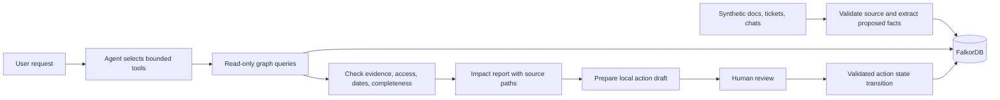

# Proposed architecture

Status: design only. No client version, model provider, Cypher query, or deployment below has been runtime-tested.

## Keep the system small

Use a thin web UI, one Python API service, an official FalkorDB client, one model provider, and a persistent FalkorDB instance. Python is a recommendation for typed extraction and evaluation, not an existing repository constraint. A TypeScript-only stack is also reasonable if it reduces the participant's delivery time.

Start with direct tools. An orchestration framework is optional. One agent loop is enough. Raw synthetic fixtures can stay in versioned files; the graph must remain the source of queryable operational state.



Graph queries produce candidate paths. Deterministic checks establish temporal validity and date conflicts. The model explains the evidence and drafts text. It does not decide source authority or silently resolve conflicting commitments.

## Minimum graph model

| Node | Key properties |
| --- | --- |
| `Person` | `id`, `name`, `active` |
| `Team` | `id`, `name` |
| `Customer` | `id`, `name` |
| `Capability` | `id`, `name` |
| `Release` | `id`, `planned_date`, `status` |
| `Commitment` | `id`, `due_date`, `status`, `scope` |
| `Decision` | `id`, `status`, `effective_at`, `recorded_at` |
| `Source` | `id`, `version`, `content_hash`, `source_kind`, `visibility`, `deleted` |
| `Assertion` | `id`, `predicate`, `valid_from`, `valid_to`, `recorded_at`, `status` |
| `Action` | `id`, `idempotency_key`, `state`, `based_on_revision` |
| `Run` | `id`, `graph_revision`, `started_at`, `status` |

Dates use ISO 8601. Date-only delivery commitments use one declared company timezone. Do not silently compare local date strings with UTC timestamps.

```text
(Commitment)-[:FOR]->(Customer)
(Commitment)-[:REQUIRES]->(Capability)
(Capability)-[:DEPENDS_ON]->(Capability)
(Capability)-[:DELIVERED_BY]->(Release)
(Person)-[:MEMBER_OF]->(Team)
(Assertion)-[:SUBJECT]->(Commitment or Capability or Release)
(Assertion)-[:OBJECT]->(Person or other entity, where applicable)
(Assertion)-[:SUPPORTED_BY]->(Source)
(Decision)-[:ESTABLISHES]->(Assertion)
(Assertion)-[:SUPERSEDES]->(Assertion)
(Action)-[:ADDRESSES]->(Commitment)
(Action)-[:BASED_ON]->(Run)
```

Use assertions for facts with history, authority, or disputed values, including dates, dependencies, exceptions, and ownership. Current-state properties and edges are projections used for efficient retrieval. Each projected relation carries an `assertion_id`; every projected property has its corresponding active assertion. These projections must change together in a validated commit. If consistency cannot be established, block the affected report.

Keep the projection layer small. Do not build a generic graph ontology editor during the event.

## Source and extraction contract

Each source record contains a stable source ID, immutable version, content hash, author ID, timestamp, type, visibility, and text. Model output contains typed candidate entities and assertions with source spans. Validate the spans against the stored text and validate referenced IDs before graph mutation.

Structured tickets supply authoritative IDs and fields. Text extraction supplies candidate relations. A fixture can seed a reliable starting graph, but the demo must label seed facts separately from facts extracted during the run. Never present manually authored relationships as model discoveries.

Resolve entities by source IDs and approved aliases. Same name does not mean same person. Ambiguous names require clarification or an unresolved state.

Reject unknown relation types, invalid dates, and unsupported claims. Quarantine bad records with a readable reason. Re-ingesting the same source version must produce no new facts or actions.

## Temporal and authority rules

Use half-open validity intervals: `valid_from <= t < valid_to`, with no upper bound for an active fact. Keep `recorded_at` distinct from effective time. A late-arriving record can describe an earlier business event.

MVP supports current-state queries and retains history. Full bitemporal queries are a stretch goal. Do not claim historical “as known then” correctness unless both business validity and knowledge revision are evaluated.

An approved release decision can replace a release date. A casual message suggesting a date does not automatically supersede it. A changed technical plan does not erase an external promise. It creates a feasibility conflict that an owner must review.

Two equally authoritative, overlapping assertions remain a conflict. Do not use “newest always wins.” An exception must have explicit scope, dates, and evidence. “Probably unaffected” is not an exception.

## Candidate query shapes

These are proposed Cypher examples. They are not tested queries and are not an authorization boundary. Run them through the official client on the pinned engine before copying them into application tools. Use parameters, fixed labels, and fixed depth caps.

Find commitments that directly or indirectly require a changed release's capability:

```cypher
MATCH (r:Release {id: $release_id})
MATCH (delivered:Capability)-[delivery:DELIVERED_BY]->(r)
MATCH path=(required:Capability)-[:DEPENDS_ON*0..4]->(delivered)
MATCH (c:Commitment)-[requirement:REQUIRES]->(required)
MATCH (c)-[:FOR]->(customer:Customer)
WHERE c.status = 'open'
RETURN DISTINCT c.id, c.due_date, customer.id, r.planned_date,
       requirement.assertion_id, delivery.assertion_id, path
LIMIT 100
```

The application must inspect every dependency assertion on `path`, not only the endpoints. It must check source access, validity, approval, exceptions, and dependency semantics before presenting a conclusion. A row cap means the output may be incomplete; detect and report truncation.

Retrieve evidence for a projected relation:

```cypher
MATCH (a:Assertion {id: $assertion_id})-[:SUPPORTED_BY]->(s:Source)
WHERE s.deleted = false
RETURN a, s.id, s.version, s.visibility
LIMIT 20
```

Current ownership should be selected from approved, valid assertions rather than inferred from who posted most often. Return both the responsible person's ID and the source establishing that responsibility. Validate this tool with reassignment and overlapping-owner tests.

Do not add PageRank to choose owners. Connectivity is not accountability. Do not add an algorithm only to fill a sponsor feature list.

## Agent tools

| Tool | Result and guard |
| --- | --- |
| `resolve_entity` | Candidate IDs; returns ambiguity instead of guessing |
| `get_current_plan` | Approved current facts and conflicts at one graph revision |
| `trace_commitment_impact` | Bounded dependency paths and coverage status |
| `get_evidence` | Only authorized supporting source spans |
| `get_current_owner` | Current assignment or explicit missing/conflicting state |
| `prepare_action` | Local draft; cannot transmit messages |
| `record_action_state` | Validated transition with revision and idempotency checks |

Give the agent a step limit and a retrieval budget. Prefer explicit tools over free-form text-to-Cypher. If free-form querying is added later, use database-enforced read-only access; keyword filtering alone is not enough.

## Access and action state

Resolve user and workspace from trusted server context. Apply permissions before returning graph-derived context to the model. A private source must not leak through a node label, path, count, citation, cache, or action draft. When accessible evidence cannot justify a conclusion, return insufficient evidence. Do not reveal that a hidden document exists merely to explain refusal.

For the hackathon, use synthetic permission groups. That tests our logic; it does not validate a real Slack or Google Drive ACL connector.

Use `proposed → approved → completed` and `proposed/approved → cancelled/obsolete` for local follow-up actions. “Completed” requires an actual recorded result. Approval does not mean delivery occurred. In the MVP, the completed action can be a local task artifact, clearly labeled as such.

Before approval or execution, compare `based_on_revision` with current graph state. If a date, owner, exception, or evidence source changed, regenerate the draft. Use an idempotency key based on commitment, finding type, and material evidence revision. A wording change must not create a duplicate task.

External messaging is outside the proposed MVP. Adding it later requires recipient permissions, human review, delivery receipts, and retry-safe behavior. A local inbox avoids pretending that a simulated message was sent.

## Failure behavior

| Failure | Required behavior |
| --- | --- |
| FalkorDB unreachable | Report unavailability; no hidden fixture answer |
| Model provider unreachable | Retain deterministic results if available; label missing generation |
| Dependency absent | Unknown unless declared coverage supports a bounded conclusion |
| Cycle or depth cap | Stop safely; show coverage limit |
| Source deletion | Invalidate dependent evidence and stale drafts |
| Concurrent update during run | Retry at one revision or mark report stale |
| Injection text in a source | Treat as source content; never execute its instructions |
| Write failure | Keep prior valid revision or surface incomplete update; do not publish partial truth |

A future deployment needs authentication, protected database access, and persistent storage. Keep database ports private. The UI host alone is not the database runtime. Pin and document actual deployment configuration when implementation starts.
