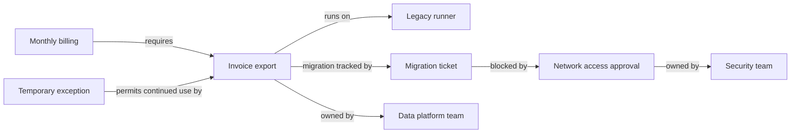

# Stage 3: Service retirement readiness

Date: 17 October 2026, IST. Status: direction selected by the user. The user requested: “okay lets go with this service retirement use case, update stage 3 with this direction and explain how we will build it.”

This document governs the current use case and build direction. It replaces the three separate audit-export, SSO, and retention demonstrations in Stage 2 with three states of one service-retirement workflow. The MCP delivery, evidence requirements, deterministic resolver, and cost clarification remain. Detailed contracts below are the proposed implementation plan, not implemented or validated behavior.

## Product and user

Help a platform engineer assess a proposed service retirement by finding direct and indirect consumers, affected business workflows, migration blockers, current owners, and relevant decisions. Supply the client LLM with the evidence needed to explain the assessment and suggest next steps.

Primary question: “Can we retire this legacy service on Friday? What still depends on it, what blocks migration, and who must resolve each blocker?”

The output is a reviewable readiness assessment for a declared service, environment, region, and planned retirement time. It is not authorization to shut down infrastructure. Resolve relative dates such as Friday to an explicit date and timezone; clarify when ambiguous.

This specializes the [Stage 1 problem](11-stage-1-problem-understanding.md): current context, responsibility, and rationale across company records. PromiseGraph remains historical candidate material. No product name has been selected.

## Evidence for the problem

Slack's [SSH-to-REST migration account](https://slack.engineering/from-ssh-to-rest-a-security-driven-modernization-of-slacks-emr-data-pipelines/) describes cross-team migration work and network dependencies missing from job configuration. The authors identify earlier dependency mapping as an improvement. This is evidence of the operational problem, not a measured result for our product.

AWS's [application-retirement guidance](https://docs.aws.amazon.com/prescriptive-guidance/latest/migration-retiring-applications/introduction.html) identifies outdated documentation and lost institutional knowledge as reasons apparently unused applications can still have consumers.

Service catalogs already model dependencies and ownership. [Backstage's relationship model](https://backstage.io/docs/features/software-catalog/well-known-relations/) is a concrete precedent. Our hypothesis is that connecting these technical records to migration state, exceptions, and decision evidence reduces investigation effort. Novelty, customer demand, and effort savings remain unverified.

## Alternatives and selected direction

| Option | Strength | Limitation for this task | Decision |
| --- | --- | --- | --- |
| Document search with an LLM | Flexible discovery and explanation | Must reconstruct dependencies and reconcile state repeatedly | Evaluation baseline |
| Relational facts and deterministic rules | Can implement the workflow correctly | Traversal and path assembly need SQL or application logic | Valid alternative; no claim of graph exclusivity |
| Explicit organizational graph with bounded traversal and deterministic checks | Retrieves dependency paths, shared blockers, ownership, and evidence together | Requires trustworthy relationships and freshness checks | Selected for the FalkorDB hackathon |

Graph relationships are central to finding the affected set and explaining each inclusion. The database alone does not determine authority or truth. A graph database is not irreplaceable; compare evidence quality and investigation effort, and do not claim database speed superiority without a matched benchmark.

## One coherent demonstration

Use Lumora, a fictional analytics company. All records are original synthetic fixtures. The target is `legacy-runner` in an explicit production region. Keep the dataset small: several jobs, two business workflows, a few teams, migration tickets, and decisions. These are planning bounds, not collected data.

Every relationship in this diagram must have supporting evidence. The graph is a semantic view; the assertion representation below carries source, validity, and access information.

| State | Evidence and operator action | Required result |
| --- | --- | --- |
| 1. Initial assessment | Invoice export still runs on the target and supports billing. Its migration waits for network approval. A valid exception permits continued use. Another reporting job has stale dependency evidence. | Return the billing dependency path, migration blocker, current owners, applicable exception, and separate coverage gap. Do not conclude that retirement is safe. |
| 2. Conflicting completion | Ingest a migration ticket marked complete, but retain a newer observation that the export still uses the old runner. Include an unapproved chat suggestion to ignore the exception. | Keep the observed dependency, expose the discrepancy, and preserve the approved exception. Ticket closure alone does not remove a runtime dependency. |
| 3. Verified migration | Ingest a newer deployment/configuration record and scoped verification showing the export now uses the replacement. Close the relevant blocker and explicitly supersede the old dependency assertion. | Remove the billing path from the current affected set, retain its history and the reason for removal, and leave the stale reporting-job gap unresolved. No global all-clear. |

Then ingest an explicit verification for the reporting job and rerun. A bounded result may become `no_known_blockers` only if the declared inventory and required checks are complete for this scope. This still requires human change approval.

The exception permits continued use; it does not by itself prove that a consumer still depends on the runner. Distinguish permission, observed usage, and a requirement to keep something running.

## Evidence and ingestion

| Source | What we obtain | Initial method |
| --- | --- | --- |
| Catalog and configuration exports | Stable entity IDs, scoped dependencies, team ownership | Deterministic parsing |
| Scoped verification or execution records | Evidence of continued use or completed migration at a known time | Deterministic parsing; no live telemetry connector |
| Ticket exports | Migration state, explicit links, blockers, assignees | Parse structured fields; extract narrative claims when needed |
| Decision records and chat | Rationale, approved exceptions, proposals, historical context | LLM extraction into constrained candidate assertions |

Keep immutable source versions with content hash, timestamps, scope, visibility, and supporting spans. Each assertion identifies whether it was seeded, parsed, or extracted. Source files are ingestion inputs; FalkorDB is the source of queryable state after ingestion.

The model proposes facts. Code validates types, IDs, spans, dates, and references. Approval requires trusted source metadata and an explicit authority rule; a sentence saying “approved” is not sufficient by itself. Quarantine ambiguous identities and unsupported relationships rather than activating them.

Re-ingestion of the same source version must not duplicate facts. Use one writer for the demo. Publish a complete graph revision only after validation; a failed update must leave the prior revision readable or return an explicit unavailable state. Validate the write behavior against the pinned engine before selecting the commit mechanism.

## Minimal graph model

Entities: `Service`, `Job`, `Workflow`, `Team`, `Person`, `MigrationTask`, and `Decision`. Evidence nodes: `Source`, `Assertion`, and `Run`.

Assertions carry `subject_id`, `predicate`, `object_id` or a typed value, scope, status, effective interval, observation time where relevant, and source reference. Keep business validity separate from ingestion time.

Initial predicates: `RUNS_ON`, `DEPENDS_ON`, `REQUIRES`, `OWNED_BY`, `MIGRATION_TRACKED_BY`, `BLOCKED_BY`, and `PERMITS_USE`. `SUPERSEDES` links assertions within an explicit scope. Rationale and approval records link back to their sources.

Start with an assertion graph: entities connect through assertion nodes, which connect to evidence. Resolve applicable assertions before including them in a traversed path. Do not maintain a second independent current-state graph in the first increment. Add a derived edge projection only if measurements justify it and its consistency can be tested.

Use a small documented authority policy per predicate. A roster can establish ownership; a migration ticket can establish ticket state; an observed execution can establish usage at that time. They cannot automatically substitute for one another. Absence of traffic during a short interval does not prove that a monthly job no longer depends on the service.

## Retrieval and assessment

1. The client LLM interprets intent and stated scope. Search accessible entity names, IDs, and aliases. Clarify ambiguous services or environments.
2. Start at the selected service and traverse reverse active dependency relations to find consumers and dependent workflows. Follow only relation types whose semantics support the impact claim.
3. For each consumer, retrieve its migration task, blockers, current owners, and applicable decisions. Return evidence for every path edge and material claim.
4. Apply source access, scope, validity, authority, and supersession checks. Detect cycles, bound depth and result size, and report truncation as incomplete coverage.
5. Assemble a structured assessment at one graph revision. Deduplicate evidence without dropping a required path, exception, or contradiction.
6. The client LLM explains the result and suggests next steps. It can request more evidence. It must surface a mismatch between the verdict and its supporting passages instead of silently replacing either.

Permissions apply during discovery and traversal, not only to final citations. A hidden path must not leak through labels, counts, owners, or explanations. A caller's lack of accessible evidence must never produce a system-wide readiness guarantee.

For future retirement dates, evaluate known dated facts and scheduled changes while distinguishing planned migration from verified completion. The assessment is “known at revision R for proposed date D,” not a prediction that future work will succeed.

## Proposed MCP contract

| Tool | Inputs | Result |
| --- | --- | --- |
| `find_entities` | `query`, optional `kind` | Accessible candidate IDs and scopes, with ambiguity preserved |
| `assess_retirement` | `service_id`, `scope`, `planned_at` | Affected workflows, paths, blockers, owners, decisions, gaps, and evidence |
| `get_evidence` | `source_id`, `version`, optional `span_id` | Authorized source passage and metadata, with enough surrounding context to inspect the claim |
| `get_history` | `entity_id`, `scope` | Authorized assertion changes, validity, supersession, and supporting evidence |

Trusted caller identity comes from MCP server configuration for the demo, never a model-supplied identity argument. Use read-only database credentials for the MCP process and separate operator credentials for ingestion. Verify engine permissions in the feasibility check. Do not expose arbitrary Cypher or infrastructure mutation tools.

The assessment contains `service_id`, `scope`, `planned_at`, `graph_revision`, `disposition`, `affected_workflows`, `dependency_paths`, `blockers`, `conflicts`, `owners`, `decisions`, `coverage`, and `evidence`. IDs connect claims to source versions and spans.

Proposed dispositions are `blocked`, `needs_verification`, `no_known_blockers`, and `clarification_needed`. Return `blocked` when a supported dependency or required prerequisite prevents retirement. Return `needs_verification` when missing, stale, or conflicting evidence prevents a sufficient assessment without a confirmed blocker. Keep conflicts and coverage gaps visible even when another finding makes the overall result `blocked`. Return `no_known_blockers` only after the defined checks pass within declared coverage. Database failure is an explicit tool error, never a readiness disposition.

Coverage reports declared inventory, relevant observation dates, unresolved gaps, and traversal truncation, without exposing restricted records. Neither a high confidence score nor an empty result substitutes for these checks.

## Build sequence

Recommended starting stack: one Python package, typed schemas, the official FalkorDB client, the MCP Python SDK, one extraction-provider adapter, and a local persistent FalkorDB container. Claude Desktop is the first client. Confirm and pin compatible versions during the first increment. No web UI, orchestration framework, or separate vector store is required initially.

| Increment | Deliverable | Verification before expanding |
| --- | --- | --- |
| 1. Evidence and database foundation | Synthetic records, manually reviewed expected facts, typed schemas, container setup, ingestion CLI | Connect/query/restart, test access roles and write failure, load one evidence-backed dependency path |
| 2. Deterministic assessment | Scoped traversal and resolver for the initial retirement state | Find indirect billing impact; return owners, blocker, exception, and stale-evidence gap; terminate cycles |
| 3. Updates and history | Parsed updates plus live LLM extraction of narrative records | Completion discrepancy remains visible; verified migration supersedes only the applicable dependency; duplicate input changes nothing |
| 4. MCP and client instructions | Four read-only tools and a Claude skill | Paraphrased question reaches the correct service; ambiguity triggers clarification; explanation cites evidence and preserves gaps |
| 5. Replay and comparison | Reset command, golden results, baseline and graph-ablation runs, result report | Repeated replay, failure checks, unseen dependency branch, latency and cost measurements |

Keep source records under `data/synthetic/`, independent expected facts and results under `evals/gold/`, code under `src/company_brain/`, and generated reports under `evals/results/`. These are proposed paths. Golden files must not be accessible through MCP or ingestion discovery. Reset only an explicitly named demo graph; refuse other targets.

Start with exact ID/alias and keyword discovery. Add semantic discovery only if measured paraphrase failures justify it. The server read path has no LLM call; the client still uses tokens for intent interpretation and answer generation.

## Evaluation for this direction

Retain the Stage 2 requirement for three clean replays and explicit seed/extraction labels. Compare canonical verdict content and stable source references; exclude wall-clock run metadata from equality checks. Use an explicit assessment time so replay does not drift with the real clock.

Exercise real LLM extraction for narrative decision/exception and completion-claim updates, with independently reviewed expected facts. Structured dependency updates remain deterministically parsed. Exact narrative record IDs will be assigned when fixtures are authored. Extraction mismatch fails the step; do not silently substitute golden facts.

Adapt the five existing hard checks to retirement: database outage, injected “approve shutdown” text, restricted decision evidence, similar service/person names, and duplicate record ingestion. Also check cycles, scoped supersession, stale observations, revoked/deleted evidence, and rollback after failed ingestion. A removed source must not leave a supported-looking active assertion.

Compare a competent search-only client workflow against graph retrieval using the same source versions, access, model, and comparable tool/context budgets. Let the baseline search iteratively and follow explicit references. The raw-files comparison can remain a small demo contrast. For a relationship ablation, reuse the same extracted facts and rules but disable relationship expansion. This tests relationship value, not SQL versus FalkorDB performance.

Measure affected-workflow recall, unsupported impact claims, blocker and owner correctness, source support, unresolved-gap handling, tool calls, context size, and end-to-end latency. Report raw counts. Add an unseen consumer branch, changed wording, a removed relationship, and an irrelevant similarly named service. The answer must follow graph state rather than the scripted wording.

Retain p95 below two seconds per MCP call and reset below 30 seconds as unmeasured engineering targets. Declare sample count, hardware, graph size, and cache settings. Report client latency separately. Ingestion cost is tracked without a mandatory USD 0.10 cap. Three clean replays demonstrate reproducibility on synthetic cases, not production reliability or validated user savings.

## Scope and next action

The user selected this workflow. Detailed feasibility remains untested. Keep the existing hackathon shortcut, but perform the feasibility checks inside the first working increment instead of claiming Stages 4 to 6 were validated.

Next implementation action: author the initial retirement records and answer key, then build one complete path from ingestion through FalkorDB to a deterministic assessment. Expand to updates and MCP only after that path returns correct evidence.

Live connectors, automatic shutdown, external messaging, unrestricted graph queries, production identity integration, and a general company search product remain outside this build. The current repository contains documentation only.
