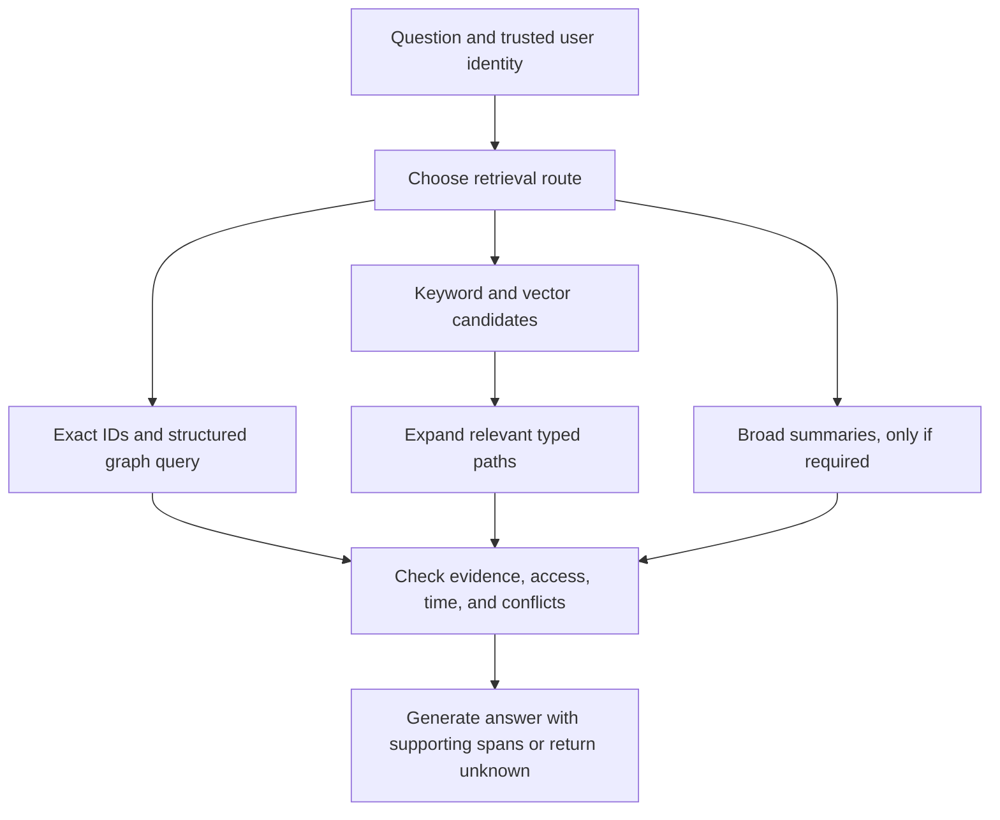

# FalkorDB: pattern transfer and experiments

Status: proposed technical options. No runtime measurements or product-direction approvals exist. Read alongside [implementation research](13-neo4j-and-graphrag-implementation-research.md).

## Use the engine well before changing the engine

Our immediate opportunity is to improve data modeling, extraction, retrieval, and verification. Forking FalkorDB or inventing a new database algorithm would add risk without establishing user value. Test the existing engine against our workload first.

Separate application quality from database performance. A more accurate answer usually depends on better evidence and retrieval. A faster query depends on query shape, indexes, data size, and engine behavior. A faster engine does not repair an invented relation.

## Capabilities and portability

| Learned pattern | FalkorDB route | Portability status |
| --- | --- | --- |
| Property graph and source lineage | Cypher plus application schema | Appropriate pattern; schema still needs implementation |
| Vector candidate search | Native vector index procedures | Documented, not tested here |
| Keyword candidate search | Native full-text procedures | Documented, not tested here |
| Hybrid score fusion | Application ranking or verified query composition | Do not assume Neo4j SDK classes work |
| Typed graph expansion | Fixed, parameterized Cypher tools | Verify supported syntax and bounds |
| Temporal facts | Explicit assertions or Graphiti adapter | Validate authority and invalidation behavior |
| Community summaries | Optional offline clustering and summaries | Different algorithm implementations are not interchangeable |
| Associative graph ranking | Optional experiment | Standard PageRank is not automatically Personalized PageRank |

FalkorDB's [vector indexing guide](https://docs.falkordb.com/cypher/indexing/vector-index) documents node and relationship similarity queries. Its [full-text guide](https://docs.falkordb.com/cypher/indexing/fulltext-index) documents text-search procedures. Their names and argument shapes differ from Neo4j's. Translate the retrieval design, not just the driver URL.

The [algorithm catalog](https://docs.falkordb.com/algorithms) lists pathfinding, ranking, and community options. Do not assume APOC, Neo4j GDS, Leiden, or seeded Personalized PageRank are available with identical semantics. Inspect the chosen procedure and test it on the pinned version. We do not currently need those algorithms to implement bounded relationship tools.

## Candidate retrieval design

This is a proposed pattern, not an implementation commitment. Start with exact queries and hybrid-plus-expansion. Add summaries or ranking only if the selected user task needs them and a baseline exposes a gap.

## Accuracy improvements to test

Use authoritative IDs from structured records. Resolve exact aliases first. Use embeddings to propose uncertain matches, not silently merge them. Measure incorrect merges as well as missed merges.

Constrain extraction to relations required by the task. Preserve source spans, versions, timestamps, and approval status. Keep structured system-of-record facts separate from model-inferred candidates. Do not treat a model's confidence number as a calibrated probability of truth.

Expand only relationship types relevant to the question. Bound depth, visited nodes, and returned evidence. More graph context can introduce irrelevant facts. A shorter path is not automatically more authoritative.

Apply authorization and temporal validity before context reaches the answer model. Preserve the evidence needed for each claim through compression. Check citations against claims and abstain when evidence is absent, inaccessible, contradictory, or incomplete.

These are hypotheses for improving our application. Several existing products already use versions of these techniques; they are not novelty claims.

## Efficiency improvements to test

Use deterministic ingestion for structured data and model extraction for genuinely unstructured text. Hash immutable source versions to avoid repeat extraction. Batch changed records. Recompute only affected facts and summaries where dependencies permit it.

Fuse keyword and vector ranks in a small candidate pool. Rank fusion is an initial option when raw score scales differ, not a guaranteed winner over normalized weighted scores. Evaluate both if retrieval errors justify it.

Retrieve a compact evidence subgraph instead of dumping all neighbors into a prompt. Cache only with workspace, access state, graph revision, and retrieval configuration in the key. A stale or cross-user cache can invalidate apparent speed gains.

Measure embedding, search, graph expansion, reranking, generation, and ingestion separately. Optimize the measured bottleneck. A small saving in query time may have little effect when model calls dominate.

## Experiments before selecting an approach

| Experiment | Comparison | Primary measure |
| --- | --- | --- |
| Document lookup | Hybrid search versus hybrid plus graph expansion | Supported-answer accuracy, latency, cost |
| Relationship questions | Same candidates with and without typed expansion | Required-evidence recall and false additions |
| Entity identity | Name merging versus stable-ID/alias resolution | Incorrect merge rate and unresolved cases |
| Current truth | Latest timestamp versus explicit approval and validity | Correct active fact selection |
| Evidence budget | Small versus larger path neighborhoods | Accuracy per token and distractor errors |
| Source change | Full re-ingestion versus incremental update | Update cost, stale facts, deletion correctness |
| Broad themes, if needed | Chunk retrieval versus community summaries | Coverage, source support, indexing and query costs |

Keep model, source corpus, permissions, and answer budget fixed where possible. Add an iterative hybrid-search agent as a competent baseline. A one-shot vector comparison alone cannot isolate graph benefits.

For engine performance, a Neo4j/FalkorDB comparison would require matched logical data, equivalent indexes and queries, declared resources and versions, cold/warm conditions, and concurrency measurements. Do not infer engine superiority from unrelated vendor charts. This experiment is optional; the event's mandatory database choice is already known.

## Framework choice remains task-dependent

For ownership, impact, and exact business-state questions, a small schema plus the official FalkorDB client is a reasonable starting candidate. For temporal conversation and evolving-context retrieval, test Graphiti's FalkorDB adapter. For document extraction and grounded Q&A, test FalkorDB GraphRAG SDK.

Do not combine all three automatically. Select based on source-lineage, update, access, and retrieval tests. The earlier product-specific architecture remains provisional until the user problem and success criteria are approved.

## Decision for the current stage

Retain three solution patterns for later comparison: structured graph tools, hybrid search with graph expansion, and temporal-memory retrieval. Keep community summaries and associative ranking as optional methods for questions that need them. Return to user-problem selection with this evidence rather than turning every database feature into a product feature.
